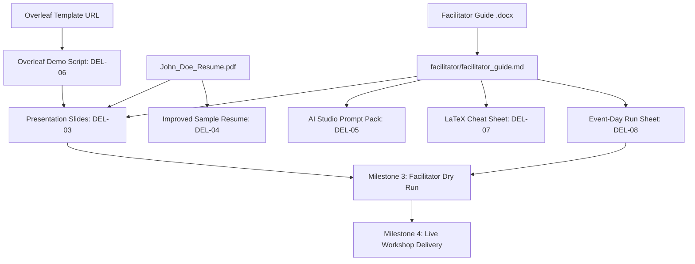

# Workshop Roadmap & Deliverables Tracker

> **Mission:** Deliver a high-impact, zero-friction 75-minute workshop (+ 15-minute buffer) equipping engineering students with practical Overleaf and Google AI Studio resume-engineering skills.

---

## 1. Project Milestones & Delivery Schedule

```
+-----------------------------------------------------------------------------------------+
| Milestone 1: Repository Architecture & Context Baseline                     [STATUS: DONE] |
| - Source inventory, decisions log, project context, contribution workflows                |
+-----------------------------------------------------------------------------------------+
                                            |
                                            v
+-----------------------------------------------------------------------------------------+
| Milestone 2: Core Educational Deliverables                                [STATUS: READY] |
| - Slide deck outline & deck, Improved resume, AI Studio prompt pack, LaTeX cheat sheet  |
+-----------------------------------------------------------------------------------------+
                                            |
                                            v
+-----------------------------------------------------------------------------------------+
| Milestone 3: Operational Logistics & Dry Run                              [STATUS: PENDING]|
| - Event-day run sheet, venue & WiFi checklist, AV verification, volunteer briefings      |
+-----------------------------------------------------------------------------------------+
                                            |
                                            v
+-----------------------------------------------------------------------------------------+
| Milestone 4: Event Delivery & Buffer Management                           [STATUS: PLANNED]|
| - Live delivery (75m core + 15m buffer), hands-on roaming support, PDF exports           |
+-----------------------------------------------------------------------------------------+
                                            |
                                            v
+-----------------------------------------------------------------------------------------+
| Milestone 5: Post-Event Retrospective & Open Sourcing                     [STATUS: PLANNED]|
| - Student feedback synthesis, template maintenance, reusable workshop kit archiving     |
+-----------------------------------------------------------------------------------------+
```

---

## 2. Deliverables Matrix

| ID | Deliverable Item | Target File / Location | Priority | Dependencies | Status |
| :--- | :--- | :--- | :--- | :--- | :--- |
| **DEL-01** | Repository Architecture & Docs | `PROJECT_CONTEXT.md`, `README.md`, `CONTRIBUTING.md` | **Critical** | None | **Done** |
| **DEL-02** | Master Facilitator Guide (MD) | `facilitator/facilitator_guide.md` | **Critical** | `Resume_..._Guide.docx` | **In Progress** |
| **DEL-03** | Workshop Presentation Slides | `slides/` | **Critical** | Facilitator Guide, John Doe flaws | **Ready to Claim** |
| **DEL-04** | Improved Sample Resume (PDF + TeX) | `resumes/improved/` | **High** | Weak John Doe Baseline | **Ready to Claim** |
| **DEL-05** | Google AI Studio Prompt Pack | `ai-studio/master_prompt.md`, `ai-studio/prompt_examples.md` | **Critical** | Facilitator Guide §12 | **In Progress** |
| **DEL-06** | Overleaf Hands-on Demo Script | `overleaf/demo_script.md` | **High** | Overleaf Template Access | **Ready to Claim** |
| **DEL-07** | LaTeX Quick Reference Cheat Sheet | `overleaf/latex_cheatsheet.md` | **Medium** | Facilitator Guide §9 | **In Progress** |
| **DEL-08** | Event-Day Run Sheet & Timeline | `logistics/event_day_run_sheet.md` | **High** | Master Timing (75m + 15m) | **In Progress** |
| **DEL-09** | Logistics & Technical Checklist | `logistics/technical_checklist.md` | **High** | Venue details (pending) | **In Progress** |
| **DEL-10** | Pre-Event Communications & Setup Guide | `logistics/student_preparation_guide.md`| **Medium** | Account requirements | **Ready to Claim** |

---

## 3. Dependency Graph



---

## 4. Status of Project Facts vs. Unresolved Questions

### A. Confirmed Facts (Authoritative)
1. **Audience:** First- and second-year undergraduate engineering students.
2. **Session Duration:** 75 minutes of instructional content, plus a 15-minute external operational buffer (Total: 90 minutes room booking).
3. **Instructional Sequence:**
   - 00–05m: Critique weak John Doe resume.
   - 05–12m: Resume anatomy, sections, and one-page rule.
   - 12–25m: Project selection (3-Question Test) and bullet formula (`Action + What + How + Result`).
   - 25–43m: Overleaf demonstration and basic LaTeX syntax.
   - 43–48m: 5-minute independent drafting sprint.
   - 48–53m: Google AI Studio orientation (editor, not creator; strict anti-hallucination).
   - 53–71m: AI Studio project bullet refinement with live student drafts.
   - 71–75m: Quality check, compilation, and takeaways.
4. **Pedagogical Constraints:** No fabricated achievements, fake metrics, or exaggerated responsibilities. Substance over visual styling.
5. **Overleaf Starter Template:** Official link confirmed as `https://www.overleaf.com/project/6ac64229826766883d011260`.

### B. Working Assumptions (To be verified)
1. **Device Availability:** All attending students will bring a personal laptop and charger.
2. **Connectivity:** The venue will provide campus Wi-Fi capable of supporting concurrent HTTP/WebSocket traffic for ~50–100 active connections (Overleaf and Google AI Studio).
3. **Presenter Machine:** The lead facilitator will project from a personal laptop equipped with HDMI/Type-C display output.
4. **Team Capacity:** 2–3 roaming student volunteers will assist attendees with Overleaf errors and account creation during the session.

### C. Unresolved Decisions & Open Questions (Awaiting User Input)
* **DEC-OPEN-01 (Venue & Date):** What is the exact campus venue (room/hall), confirmed calendar date, and start/finish clock time?
* **DEC-OPEN-02 (Registration Scale):** What is the expected student turnout (e.g., 30, 60, 100+ attendees)?
* **DEC-OPEN-03 (Slide Deck Format):** Should presentation slides be maintained in Google Slides (with link provided), Markdown (Marp / Sli.dev), or LaTeX Beamer?
* **DEC-OPEN-04 (Lead Facilitators & TAs):** Who are the assigned lead speaker(s) and roaming technical assistants?
* **DEC-OPEN-05 (Pre-requisite Enforcement):** How will we ensure students create Overleaf and Google accounts prior to entering the workshop?
